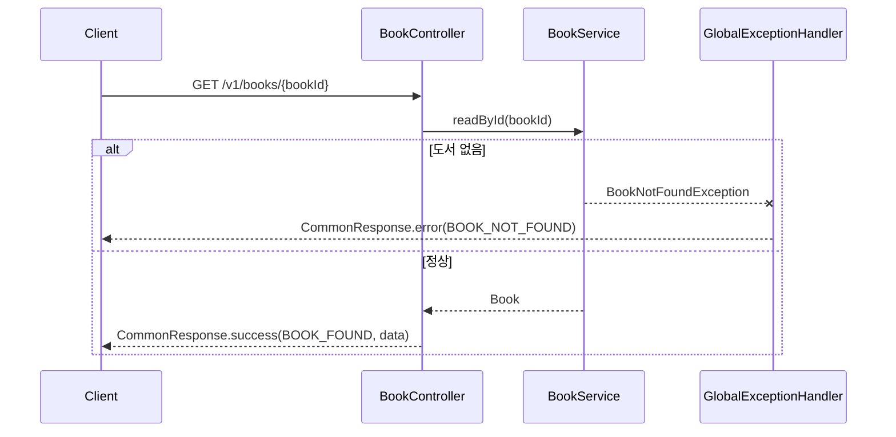

# AGENTS.md

Aladin Server — PLAY SOPT 39기 합동세미나 Mobile-Web 3조 알라딘 클론 백엔드.
도서 조회와 중고 도서 거래 API를 도메인별로 구현합니다. 프로젝트 소개와 실행 방법은 [README.md](README.md)를 따릅니다.

## 기술 스택

Java 21 · Spring Boot 4.1.2 · Gradle · Spring Data JPA · Supabase PostgreSQL · SpringDoc OpenAPI · Lombok

## 명령어

```bash
./gradlew bootRun              # 로컬 실행 (.env 필요)
./gradlew test                 # 테스트
./gradlew clean test bootJar   # CI와 동일한 빌드
```

Windows PowerShell에서는 `.\gradlew.bat`을 사용합니다.
Swagger UI: `http://localhost:8080/swagger-ui/index.html`

## 아키텍처

모놀리식 단일 애플리케이션 + **도메인형 패키지 구조**(Controller-Service-Repository 패턴 유지)로 확정했습니다.
계층형, 클린, 헥사고날 아키텍처는 채택하지 않았으니 도입하지 않습니다.

기본 패키지는 `sopt.collaboration.aladin`입니다.

```text
sopt.collaboration.aladin
├─ domain/
│  └─ <도메인명>/
│     ├─ controller/              # REST 엔드포인트
│     │  ├─ XxxApi.java           # Swagger 어노테이션 전용 인터페이스
│     │  ├─ XxxController.java    # 인터페이스 구현체
│     │  └─ dto/{request,response}/
│     ├─ service/
│     │  ├─ XxxService.java
│     │  └─ vo/                   # 서비스 계층 내부 VO (record)
│     ├─ repository/              # JpaRepository 인터페이스
│     ├─ entity/                  # JPA 엔티티 + enum
│     ├─ code/                    # XxxErrorCode, XxxSuccessCode
│     └─ exception/               # BusinessException 하위
└─ global/
   ├─ code/        # ErrorCode, SuccessCode, GlobalErrorCode
   ├─ config/      # SwaggerConfig, WebConfig
   ├─ dto/         # CommonResponse
   ├─ entity/      # BaseTimeEntity
   └─ exception/   # BusinessException, GlobalExceptionHandler
```

- 현재는 `global`만 구현되어 있고, 도메인(`book`, `usedbook` 등)은 위 구조를 그대로 따라 추가합니다.
- `global`의 `converter/`, `swagger/`(`@ApiExceptions`), `IdResponse`는 아직 없습니다. 필요해질 때 팀과 합의해 추가하고, 없는 클래스를 있는 것처럼 참조하지 않습니다.
- 도메인 간 의존은 한쪽이 다른 쪽의 `entity`/`service`를 사용하는 것까지 허용하지만, 반대 방향 의존을 만들지 않고 단방향을 유지합니다.

## 코드 컨벤션

### 엔티티

- `@Entity` `@Getter` `@Table(name = "...")` `@NoArgsConstructor(access = AccessLevel.PROTECTED)`로 시작합니다. `@Setter`는 쓰지 않고, 상태 변경은 의미 있는 도메인 메서드로 노출합니다. 필드는 모두 `private`.
- `created_at`, `updated_at`이 있는 테이블은 `BaseTimeEntity`를 상속합니다. 타임스탬프가 없는 정션·디테일 테이블은 상속하지 않습니다.
- PK는 기본 `@GeneratedValue(strategy = GenerationType.IDENTITY)`. PK 자체가 FK인 경우에는 `@GeneratedValue`를 붙이지 않습니다.
- FK는 `Long` ID 컬럼과 관계 객체를 함께 두는 **이중 매핑**으로 작성합니다. 관계 객체는 항상 `LAZY`, `insertable = false, updatable = false`이며 쓰기는 ID 컬럼으로만 합니다.

```java
@Column(name = "album_id", nullable = false)
private Long albumId;

@ManyToOne(fetch = FetchType.LAZY)
@JoinColumn(name = "album_id", insertable = false, updatable = false)
private Album album;
```

- NOT NULL은 `@Column(nullable = false)`, TEXT는 `columnDefinition = "TEXT"`, Enum은 반드시 `@Enumerated(EnumType.STRING)`.

### Repository

- `JpaRepository<Entity, Long>`을 확장하고, 엔티티가 여러 개면 엔티티별로 Repository를 따로 둡니다.
- 메서드명은 Spring Data 파생 규칙을 우선합니다. N+1을 피해야 하는 조회만 `@Query`의 `join fetch`로 명시합니다.

### Service

- `@Service` `@RequiredArgsConstructor` `@Transactional(readOnly = true)`를 클래스에 두고, 쓰기 메서드만 `@Transactional`로 덮어씁니다.
- 의존성은 `private final` 생성자 주입만 사용합니다. `@Autowired` 필드 주입은 금지입니다.
- 책임이 다르면 서비스를 분리하고, 검증만 하는 책임은 `XxxValidator`로 분리합니다.
- 네이밍: ID 단순 조회는 `read...`, 그 외는 `find...`. 없으면 예외를 던지는 조회는 `findByIdOrThrow`처럼 이름에 드러냅니다.
- 여러 엔티티를 묶어 반환해야 하면 `service/vo/`에 record로 VO를 만듭니다. (예: `BookWithDetail`)
- Service는 도메인 엔티티 또는 VO를 반환하며, Controller의 요청·응답 DTO에 의존하지 않습니다. 응답 DTO 변환은 Controller에서 DTO의 정적 팩토리 메서드 `of(...)`를 호출해 처리합니다.

### Controller / DTO

- URL은 버전 prefix가 붙은 복수형 자원입니다. (`/v1/books`)
- Swagger 어노테이션은 `XxxApi` 인터페이스에 두고, `XxxController`가 구현합니다. 컨트롤러 본체는 어노테이션 노이즈 없이 유지합니다.
- 모든 응답은 `CommonResponse<T>`로 감쌉니다. `CommonResponse.success(SuccessCode, data)`, 데이터가 없으면 `CommonResponse.success(SuccessCode)`.
- DTO는 모두 `record`이고, 변환 책임은 DTO 안의 정적 팩토리 `of(...)`에 둡니다. 응답 안에서만 쓰는 하위 구조는 중첩 record로 둡니다.
- DTO 필드에는 `@Schema(description = "...", example = "...")`를 붙입니다.
- 요청 검증은 Spring Validation 어노테이션으로 처리합니다. 페이지 번호는 1부터 시작합니다.

### 에러·성공 코드와 예외

- 도메인별로 `XxxErrorCode implements ErrorCode`, `XxxSuccessCode implements SuccessCode` enum을 만듭니다. 상수명은 `<도메인>_<상태>` 대문자 SNAKE_CASE(`BOOK_NOT_FOUND`), 메시지는 사용자에게 노출되는 한국어 문장입니다.

```java
@Getter
@RequiredArgsConstructor
public enum BookErrorCode implements ErrorCode {
    BOOK_NOT_FOUND(HttpStatus.NOT_FOUND, "도서 정보를 찾을 수 없습니다.");

    private final HttpStatus status;
    private final String message;
}
```

- 비즈니스 예외는 `BusinessException`을 상속하고 **no-args 생성자**를 둡니다. (향후 `@ApiExceptions`가 리플렉션으로 인스턴스를 만들 때 필요)
- 실패 응답은 직접 만들지 않습니다. 예외만 던지면 `GlobalExceptionHandler`가 `CommonResponse.error(...)`로 변환합니다. 컨트롤러·서비스에서 `try-catch`로 응답을 만들지 않습니다.
- 바인딩·검증 실패는 글로벌 핸들러가 `CommonResponse.validationError(...)`로 변환합니다.

## 새 API 추가 순서

1. `entity/` — 필요한 엔티티·연관관계 점검
2. `repository/` — 필요한 조회 메서드 추가
3. `code/` — `XxxErrorCode`, `XxxSuccessCode` 상수 추가
4. `exception/` — `BusinessException` 하위 예외 추가
5. `service/` — 트랜잭션·검증·조회 로직 (필요 시 `service/vo/`)
6. `controller/dto/{request,response}/` — record DTO + `@Schema`
7. `controller/XxxApi` — `@Tag`, `@Operation`
8. `controller/XxxController` — `@RestController` 구현체
9. Swagger UI에서 응답·에러 예시가 의도대로 나오는지 확인

## Git 컨벤션

- 브랜치: `{type}/#{issue-number}-{영어-짧은-이름}` — 예: `feat/#1-api-response-codes`
- 커밋: 한국어로 `{type}: {description} - #{issue-number}` — 예: `feat: 도서 상세 조회 API 구현 - #10`
- 타입: `feat` `fix` `refactor` `docs` `style` `test` `build` `chore` `ci`
- 이슈 제목에는 라벨 없이 기능만 적습니다. — 예: `공통 API 응답 및 성공·에러 코드 체계 도입`
- PR 제목: `[Feat/#5] 테스트 기능 구현` 형식 (기능 + 이슈 번호). `Refactor: 테스트` 같은 형식은 쓰지 않습니다.
- PR 본문은 [.github/pull_request_template.md](.github/pull_request_template.md)를 따르고, **Swagger 테스트 결과를 반드시 포함**합니다.
- 코드 리뷰는 PN 규칙(P1~P5)을 따릅니다. 기준은 PR 템플릿에 있습니다.
- `main`에 push되면 GitHub Actions가 자동으로 빌드·배포합니다. `main`에 직접 push하지 말고 PR을 사용합니다.

## PR 다이어그램 (Mermaid)

구조나 흐름이 바뀌는 PR은 본문에 Mermaid 다이어그램을 넣습니다. GitHub가 PR 본문·코멘트에서 바로 렌더링하므로 이미지 파일이나 별도 문서 없이 코드로 둡니다.

- 대상: 새 도메인 추가, 도메인 간 의존 변경, 테이블·연관관계 변경, 외부 연동, 배포 흐름 변경처럼 코드만 보고 전체를 파악하기 어려운 변경. 단순 버그 수정이나 한두 줄 수정에는 넣지 않습니다.
- 위치: PR 템플릿의 `📊다이어그램` 항목. 코드블록은 ` ```mermaid `로 시작합니다.
- 종류: 구성·의존은 `flowchart`, 요청 흐름은 `sequenceDiagram`, 테이블 관계는 `erDiagram`.
- 한 다이어그램은 한 가지 주제만 다루고, 노드가 15개를 넘으면 나눕니다.
- 실제 코드·스키마에 있는 것만 그립니다. 예정된 내용은 `(예정)`으로 표시합니다.

예시:

````markdown

````

## 하지 말 것

- `.env`, DB 접속 정보, 시크릿을 커밋하거나 코드·로그·문서에 적지 않습니다.
- 요청받지 않은 리팩터링이나 의존성 추가를 하지 않습니다.
- 현재 요구사항을 넘는 추상화를 만들지 않습니다.
